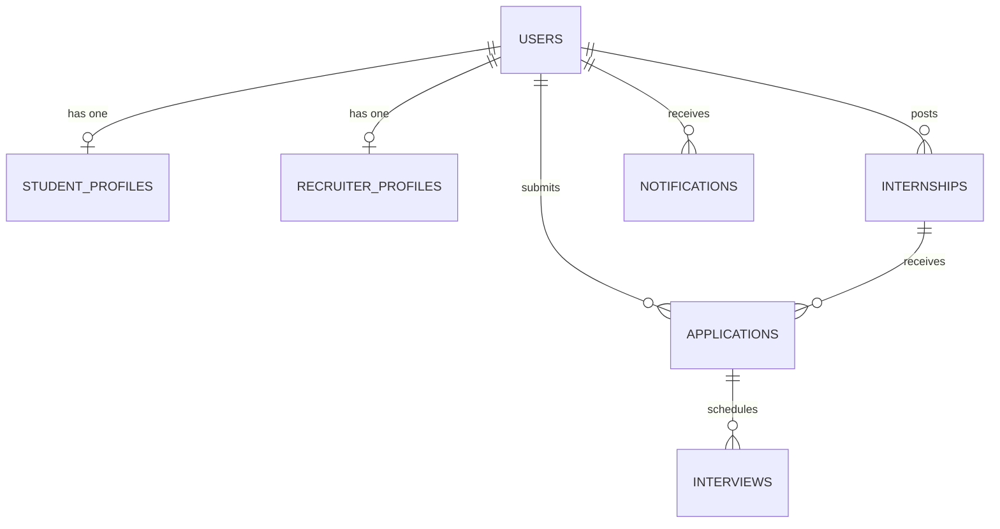

# InternPortal – Online Internship Management System

A modern, responsive, and full-stack web platform built for college campus placements, internship discovery, and end-to-end recruitment lifecycle automation.

---

## 🎯 Key Highlights

- **Smart AI Skill Matching**: Real-time compatibility calculation comparing student competencies against internship prerequisites, identifying skill gaps, and providing actionable learning recommendations.
- **Three-Tier Role-Based Access Control**:
  - **🎓 Student Portal**: Search & filter internships, upload PDF resumes, check resume completeness score, apply with custom cover notes, and follow multi-stage progress tracking.
  - **🏢 Recruiter Portal**: Post and manage internships, filter applicants by minimum skill match score, inspect resumes, shortlist/reject candidates, and schedule live video interviews.
  - **🛡️ Administrator Console**: Platform analytics, visual conversion funnels, recruiter verification approval queue, user moderation, and one-click CSV placement report export.
- **Interactive Lifecycle Tracker**: Real-time status pipeline from `APPLIED` ➔ `UNDER_REVIEW` ➔ `SHORTLISTED` ➔ `INTERVIEW_SCHEDULED` ➔ `SELECTED` / `REJECTED`.
- **Integrated Video Interview Scheduling**: Schedule Google Meet, Zoom, or WebRTC sessions with date/time selectors, direct join buttons, and instructions.
- **Duplicate Prevention & Resume Completeness Checker**: Safeguards preventing duplicate applications and scoring profile readiness up to 100%.

---

## 🏗️ Technical Architecture

### 1. Frontend
- **Framework**: React.js 18 with Vite
- **Styling**: Vanilla CSS Design System with curated tokens (Modern Blue-and-White Palette `#2563eb`, `#0f172a`, `#f8fafc`)
- **Icons**: Lucide React
- **Typography**: Google Fonts (*Plus Jakarta Sans* & *Inter*)
- **State Management**: Reactive React Context (`AuthContext`, `AppContext`) with fallback to local persistent cache for standalone presentation readiness

### 2. Backend
- **Framework**: Java 17, Spring Boot 3.2.4
- **Security**: Spring Security 6 with stateless JWT Bearer Token Authentication
- **Data Access**: Spring Data JPA & Hibernate ORM
- **File Uploads**: Spring Multipart handling for secure PDF resume uploads
- **Architecture**: Modular layered pattern (`controller` ➔ `service` ➔ `repository` ➔ `entity`)

### 3. Database
- **Engine**: MySQL 8.x
- **Schema**: 8 relational tables (`users`, `student_profiles`, `recruiter_profiles`, `internships`, `applications`, `interviews`, `notifications`, `saved_internships`)
- **Seed Data**: Pre-configured sample users, companies, listings, and applications

---

## 🚀 Quick Start Guide

### Option A: Launching the Frontend (Currently Live!)

The React frontend runs on port **3000** with integrated presentation demo switching:

```bash
cd frontend
npm install
npm run dev
```

Visit: **[http://localhost:3000](http://localhost:3000)**

#### 🔑 Demo Accounts (Available with 1-Click in the Top Banner)
| Role | Name | Email | Password |
|------|------|-------|----------|
| **Student** | Aarav Sharma | `aarav.sharma@college.edu` | `password123` |
| **Recruiter** | TechCorp HR | `recruiter@techcorp.io` | `password123` |
| **Admin** | College Placement Cell | `admin@internportal.com` | `password123` |

---

### Option B: Running the Java Spring Boot Backend

#### 1. Setup MySQL Database
Create the database and load schema and sample data:
```sql
CREATE DATABASE internportal_db;
USE internportal_db;
-- Execute backend/src/main/resources/schema.sql
-- Execute backend/src/main/resources/data.sql
```

#### 2. Configure Database Credentials
Edit [`backend/src/main/resources/application.properties`](file:///backend/src/main/resources/application.properties):
```properties
spring.datasource.url=jdbc:mysql://localhost:3306/internportal_db?useSSL=false&serverTimezone=UTC
spring.datasource.username=root
spring.datasource.password=YOUR_MYSQL_PASSWORD
```

#### 3. Run with Maven
```bash
cd backend
mvn clean spring-boot:run
```
The REST API server starts on **`http://localhost:8080/api`**.

---

## 📄 Pages Included

1. **Home Page**: Hero search bar, live platform stats, domain categories, featured cards, and workflow guides.
2. **Login & Registration Pages**: Unified role-based auth with one-click presentation logins.
3. **Student Dashboard**: Stat cards, interview alerts, AI recommendations, and resume completeness gauge.
4. **Student Profile**: Academic records, verified skills tagger, PDF resume upload, and portfolio links.
5. **Internship Listings**: Multi-criteria filtering (domain, stipend range, work mode, duration) and sorting.
6. **Internship Detail**: Job description, responsibilities, eligibility criteria, smart match gauge, and apply modal.
7. **Application Tracker**: Visual stage progression timeline with recruiter notes and interview join buttons.
8. **Recruiter Dashboard**: Active postings overview, candidate pipeline stats, and quick-post shortcut.
9. **Applicant Management**: Filter by role, status, and skill match %, inspect resumes, and advance stages.
10. **Post Internship**: Full posting form with compensation, eligibility, and required skills tagging.
11. **Interview Scheduling**: Centralized video interview calendar.
12. **Admin Dashboard**: Conversion funnel charts, recruiter verification queue, user moderation, and CSV export.
13. **Notifications Center**: Real-time application updates and deadline alerts with unread counter.
14. **About Us**: System architecture documentation for academic presentation.
15. **Contact Us**: Placement cell desk details, inquiry submission form, and FAQ accordion.

---

## 📊 Database ER Diagram



---

## 🎓 Academic Mini-Project Presentation Ready

This project is structured for evaluation in college engineering seminars, mini-project reviews, and software engineering practicals. It provides clear separation of concerns, modern design aesthetics, and robust full-stack implementation.
